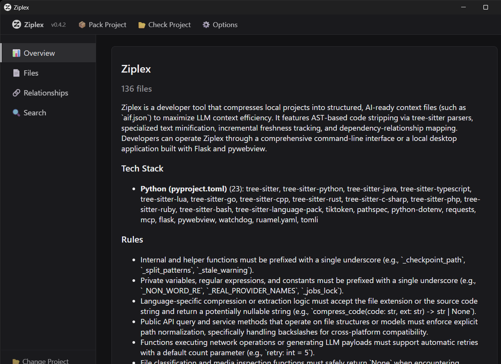

# Ziplex

**English** | [한국어](README_ko.md)

**Which tests does this change affect, and what depends on this file? Ziplex answers from a zero-config dependency graph — for your CI, your editor hook and your coding agent.**

Ziplex parses a project with Tree-sitter and resolves imports the way the toolchain does — relative/index files, tsconfig `paths` aliases, pnpm/npm workspace packages and their `exports`, Python packages, re-exports, `conftest.py` and package `__init__.py` files, Go packages — into one graph across languages. It keeps that graph in an incremental local index (no LLM, no network, no API key) and answers from it in milliseconds.

> ⚠️ Under active development. Interfaces may still change.

---

## Where it helps

- **Running only the tests a change can affect** — locally (`pytest $(ziplex impact --format paths)`) or on every pull request ([CI template](docs/ci/impacted-tests.yml)). Measured on 99 real commits of repos Ziplex was never tuned on: recall 0.976, or 0.988 without the imports pytest itself makes ([eval](eval/README.md)). It falls back to the full suite whenever a targeted run isn't safe.
- **Giving a coding agent the impact answers grep can't produce in one step** — `ziplex-mcp` answers "which tests cover this change", "what is transitively affected", "how does A reach B". On held-out repos, Claude Code with it spent 57% less and finished 55% faster on those questions, at the same accuracy ([EXPERIMENTS #15](docs/EXPERIMENTS.md)).
- **Polyglot and monorepo codebases** — a TypeScript frontend, a Python backend and shared workspace packages resolve into one graph, with no per-language tool to configure.
- **An editor hook** — after Claude Code edits a file, one line tells it how many files depend on it and which tests to run.

Honest scope: for a direct "who imports X" question a single grep is already enough (the MCP costs ~12% more there), and in small, local bug fixes agents gained nothing measurable from it ([EXPERIMENTS #16](docs/EXPERIMENTS.md)). The value is in transitive impact and test selection.

## Quick start

```bash
pip install ziplex                      # or: pipx install ziplex
cd your-project
ziplex impact                           # tests affected by your uncommitted changes
pytest $(ziplex impact --format paths)  # run just those (prints nothing -> full suite when unsure)
ziplex deps src/app.py --in --depth 2   # who depends on a file, by hop
ziplex install claude --hook            # register the MCP server + post-edit hook with Claude Code
```

The first command builds `.ziplex/index.db` (gitignored automatically; django's 5,700 files take ~10s, later updates under a second). More in [Graph index](#graph-index-deps-impacted-tests-editor-hook), [MCP server](#mcp-server) and the [CI template](docs/ci/impacted-tests.yml).

## Install

```bash
pip install ziplex            # the graph: index, deps, impact, path, MCP server, editor hook
pip install "ziplex[llm]"     # + LLM-written summaries for `ziplex pack` (requests, python-dotenv, tiktoken)
pip install "ziplex[gui]"     # + the read-only viewer `ziplex-gui` (flask, pywebview, watchdog)
pip install "ziplex[all]"     # both
```

`pipx install ziplex` keeps it in its own environment with the commands on PATH. On Windows, if `ziplex` isn't found after a plain `pip install`, pip installed per-user into a `Scripts` folder that isn't on PATH (it prints a warning saying which) — add that folder to PATH or use pipx.

## Graph index: deps, impacted tests, editor hook

No pack and no LLM: these commands keep an incremental dependency-graph index in `<project>/.ziplex/index.db` (a disposable cache, gitignored automatically) and answer from it. The project defaults to the current directory.

```bash
ziplex index [--check]                        # build/refresh the index; --check exits 1 if anything changed
ziplex deps src/app.py                        # what it imports (with line numbers)
ziplex deps src/app.py --in --depth 2         # who depends on it, by hop
ziplex impact                                 # tests affected by your uncommitted changes (= --diff worktree)
ziplex impact --diff origin/main...HEAD       # ... by a branch
pytest $(ziplex impact --format paths)        # run just those tests
ziplex path src/app.py src/db.py              # shortest import chain
ziplex tree .                                 # the whole dependency tree
```

What it resolves: relative and index-file imports, tsconfig/jsconfig `paths` and `baseUrl`, pnpm/npm/yarn workspace packages and their `exports` (conditions, wildcards), Python packages from any source root (src-layout included), re-exports through `__init__.py`, Go packages via `go.mod`, C/C++ includes, Godot `res://` references, plus prose mentions of file paths in docs and configs (kept separate, never counted as dependents). Tests are found by each runner's own conventions; `conftest.py` and package `__init__.py` files count as executed-before-the-test, imports under `if TYPE_CHECKING:`/`import type`/`__main__` guards don't, and a test reached only through a function-local import is reported as *possibly* affected.

`impact --format paths` prints nothing when a targeted run isn't safe (a build/config/lockfile changed, or a file was deleted), so the `pytest $(...)` line falls back to the whole suite; the reason goes to stderr. `--format commands` prints ready-to-run `pytest`/`jest`/`vitest`/`go test` commands; `--format json` everything.

**CI**: [`docs/ci/impacted-tests.yml`](docs/ci/impacted-tests.yml) runs only the affected tests on a pull request and the full suite when needed. Keep a full run on main or nightly — dynamic imports (importlib, plugin registries) are invisible to any static graph.

**Editor hook**: `ziplex install claude --hook` registers the MCP server and adds a `PostToolUse` hook (`ziplex-hook`) to `<project>/.claude/settings.json`. After Claude edits a file it gets one line: how many files depend on it and which tests to run. It never blocks, stays silent outside indexed projects, and repeats at most once per file per 10 minutes. `--dry-run` shows the command and the settings diff without changing anything.

Measured: [recall 0.976 on 99 real commits of held-out repos](eval/README.md) for impacted tests; index build ~10s for django's 5,700 files, under a second to stay current.

## MCP server

`ziplex-mcp` gives Claude Code, Cursor or any MCP client the same live graph — no pack needed, refreshed from disk before every call.

```bash
claude mcp add ziplex -- ziplex-mcp --project /abs/path/to/project   # or: ziplex install claude
```

| Tool | What it answers |
|---|---|
| `graph_overview(scope?)` | Hubs, import cycles, folder layering, unresolved relative imports — start here in an unfamiliar repo |
| `who_depends_on(files, depth?, include_mentions?)` | Who imports these files (with the import line), or everything transitively affected, by hop |
| `dependencies_of(files, external?)` | What these files import, resolved to files |
| `impacted_tests(files?, diff?)` | Tests affected by a change or a git diff, with the import chain and a ready-to-run command |
| `dependency_path(source, target)` | The shortest import chain between two files |

Answers are compact text (tens to a few hundred tokens); the five tool definitions cost ~720 tokens per session. On held-out repos, Claude Code with these tools answered impacted-tests questions at 57% lower cost and 55% faster, with the same accuracy ([EXPERIMENTS #15](docs/EXPERIMENTS.md)).

**Legacy mode.** `ziplex-mcp --aif <name>.json [--project .]` (or `--legacy-tools`) serves the previous ten tools over a packed `aif.json` (`get_overview`, `list_files`, `get_folders`, `get_relationships`, `get_graph_summary`, `get_dependents`, `get_blast_radius`, `get_detail`, `check_freshness`, `search_project`).

## Packing a project into aif.json (optional)

`ziplex pack` writes a project's shape into one portable file: per-file summaries, inferred coding rules, an AI guide, a folder map and the resolved relationships — useful for pasting into a chat that has no tool access, committing next to the code, or browsing in the GUI. For agents that *do* have tools, the graph above is what measurably helps; LLM summaries did not beat a tool-using agent ([EXPERIMENTS](docs/EXPERIMENTS.md) #1-#9).

```bash
ziplex pack ./your-project --no-llm      # no API key: structural summaries (signatures/dependencies per file)
ziplex pack ./your-project               # LLM-written summaries, rules and guide (needs ziplex[llm] + a provider key)
```

Packing is non-interactive: every file that passes the secret scan is packed; a flagged file's content is never included, but its imports still appear in the graph. Unchanged files reuse their summaries by content hash, LLM summaries are cached as they arrive (an interrupted pack loses nothing), and a repeat `pack` with nothing changed exits immediately.

| Flag | Effect |
|---|---|
| `--no-llm` | Structural summaries only; no API key or network |
| `--no-cache` | Re-summarize everything |
| `-o, --output <path>` | Output path (plus sibling `.detail.json`/`.cache.json`); default `<project>/.ziplex/<name>.json` |
| `--include` / `--ignore <patterns>` | Comma-separated globs on top of `.ziplex.json` |
| `--lang en\|ko` | Language the summaries/rules/guide are written in |
| `--max-tokens N` (+ `--max-tokens-model M`) | Exit 1 if the saved aif.json exceeds N tokens |

<details>
<summary>LLM providers</summary>

| Provider | `LLM_PROVIDER` | Config |
|---|---|---|
| Gemini (default) | `gemini` | `GEMINI_API_KEY`, optional `GEMINI_MODEL` |
| OpenAI-compatible — OpenAI, Ollama, LM Studio, vLLM, OpenRouter, Groq, llama.cpp | `openai` | `OPENAI_API_KEY` (often unneeded locally), `OPENAI_BASE_URL`, `OPENAI_MODEL` |
| Claude | `claude` | `ANTHROPIC_API_KEY`, optional `CLAUDE_MODEL` |

Set them in a `.env`, the environment, or with `ziplex settings set <key> <value>` (`~/.ziplex/settings.json`). A local model through Ollama/LM Studio is the `openai` provider with `OPENAI_BASE_URL=http://localhost:11434/v1` (Ollama) or `http://localhost:1234/v1` (LM Studio).

</details>

<details>
<summary>Output format</summary>

| File | Contains |
|---|---|
| `aif.json` | Project guide, coding rules, folder map, token stats, one summary per file, certain dependency edges |
| `<name>.detail.json` | The compressed source per file (function bodies elided as `⋮----`) and prose mentions (`text_refs`) |
| `<name>.cache.json` | A content hash per packed file, for freshness checks and incremental re-packs |

```jsonc
{
  "project": { "name": "...", "prompt": "...", "tech_stack": [...], "security_scan": { "flagged": 0, "included_anyway": 0, "excluded": 0 },
               "scope": { "include": [], "ignore": [] }, "format_notes": "...", "language": "en", "ziplex_version": "0.7.0", "llm": true },
  "rules": ["..."],
  "folders": { "src": { "summary": "...", "file_count": 12 } },
  "tokens": { "GPT-4o": { "original": 3100, "compressed": 749, "saved_pct": 75.8 } },
  "files": { "src/App.tsx": { "summary": "..." } },
  "relationships": { "src/App.tsx": { "internal": ["..."], "external": ["react"] } }
}
```

</details>

**Exports.** `ziplex skill <name>.json` writes a [Claude Agent Skill](https://code.claude.com/docs/en/skills) (`.claude/skills/<slug>/`) that Claude Code loads on its own; `ziplex flatten <name>.json` writes one Markdown file with every summary and compressed body inline.

**Team use.** The pack is just files — commit them like any generated artifact. `ziplex freshness <project> <name>.cache.json` exits non-zero when the committed pack has drifted from the code ([CI template](docs/ci/freshness-gate.yml)); on a conflict, re-pack instead of hand-merging ([merge-conflicts.md](docs/team/merge-conflicts.md), [gitattributes](docs/team/gitattributes)).

### Config file

`ziplex init ./your-project` scaffolds `.ziplex.json` in the target project:

```jsonc
{
  "include": ["src/**/*.py", "*.md"],     // empty = everything not ignored
  "ignore": ["**/*.generated.*"],         // on top of the built-in ignores and .gitignore
  "exclude_flagged_from_graph": false     // true: drop secret-flagged files from the graph too
}
```

The graph index, `pack`, `tree` and `freshness` all read it.

## GUI

`ziplex-gui` (needs `ziplex[gui]`) is a local, read-only viewer for a packed project: overview, file tree with summaries and compressed source, dependents and blast radius, the dependency graph, search, live freshness badges. Pack with `ziplex pack`, then open the resulting aif.json. Binds to `127.0.0.1` only.



## Other commands

| Command | Description |
|---|---|
| `settings` / `settings set <key> <value>` | View/change `~/.ziplex/settings.json` (LLM provider, model, keys) |
| `doctor [<path>]` | Environment check — Python, LLM provider/key, secretlint |
| `dev collect\|tokens\|search\|detail\|signatures\|dependencies\|api\|compress\|debug ...` | Debug tools for one step of the pipeline |
| `--version` | Installed version (also `ziplex-mcp --version`) |

A bare `ziplex` prints the command list.

## Evidence and evaluation

Every direction decision is backed by a recorded comparison: [`docs/EXPERIMENTS.md`](docs/EXPERIMENTS.md) (16 rounds, including the negative results), [`eval/`](eval/README.md) (edge-accuracy ground truth, impacted-tests recall on real commits, headless agent comparisons) and the [2026-10 review](docs/REVIEW-2026-10-14.md) that set the current direction.

## Testing

```bash
pip install -e ".[dev]"
pytest
```

Nothing in the suite calls an LLM or the network. `LLM_PROVIDER=mock ziplex pack <project>` smoke-tests the LLM path offline.

## Tech stack

Python 3.10+ · [Tree-sitter](https://tree-sitter.github.io/tree-sitter/) (Python/Java/TypeScript/JavaScript/Lua/GDScript/Go/C++/Rust/C#/PHP/Ruby/Bash) · SQLite · [MCP](https://modelcontextprotocol.io/) · `pathspec` · [ruamel.yaml](https://yaml.readthedocs.io/) · optional: `requests` (Gemini / OpenAI-compatible / Claude), tiktoken, Flask, pywebview, watchdog · `secretlint` if installed

## License

[MIT](LICENSE)
