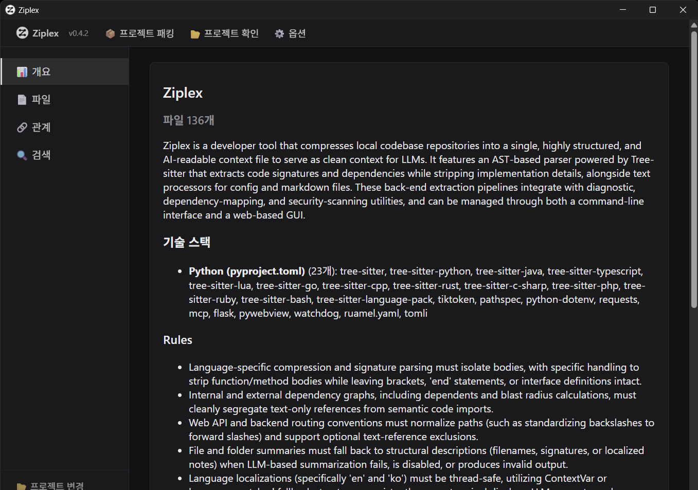

# Ziplex

[English](README.md) | **한국어**

**이 변경이 어떤 테스트에 영향을 주는지, 이 파일에 무엇이 의존하는지. Ziplex는 설정 없이 만드는 의존성 그래프로 답합니다. CI, 에디터 훅, 코딩 에이전트 어디서든 쓸 수 있습니다.**

Ziplex는 Tree-sitter로 프로젝트를 파싱하고, import를 툴체인과 같은 방식으로 해석해 여러 언어를 아우르는 그래프 하나로 만듭니다. 상대 경로와 index 파일, tsconfig `paths` alias, pnpm/npm workspace 패키지와 `exports`, Python 패키지와 re-export, `conftest.py`, 패키지 `__init__.py`, Go 패키지까지 해석합니다. 이 그래프는 로컬 증분 인덱스에 저장되고(LLM, 네트워크, API 키 모두 필요 없음), 질의에는 밀리초 단위로 답합니다.

> ⚠️ 활발히 개발 중입니다. 인터페이스가 바뀔 수 있습니다.

---

## 이럴 때 도움이 됩니다

- **변경이 영향을 줄 수 있는 테스트만 실행할 때**: 로컬에서는 `pytest $(ziplex impact --format paths)`로, PR마다는 [CI 템플릿](docs/ci/impacted-tests.yml)으로 실행합니다. Ziplex 튜닝에 한 번도 쓰지 않은 저장소의 실제 커밋 99개에서 측정한 recall은 0.976이고, pytest 자체가 하는 import를 빼면 0.988입니다([평가](eval/README.md)). 선별 실행이 안전하지 않으면 전체 스위트로 돌아갑니다.
- **grep 한 번으로는 못 하는 영향 분석을 코딩 에이전트에게 맡길 때**: `ziplex-mcp`는 "이 변경을 커버하는 테스트", "전이적으로 영향받는 파일", "A가 B에 어떻게 닿는가"에 답합니다. held-out 저장소에서 이 질문들을 풀 때 Claude Code는 같은 정확도로 비용을 57% 덜 쓰고 55% 빨리 끝냈습니다([EXPERIMENTS #15](docs/EXPERIMENTS_ko.md)).
- **다국어 프로젝트·모노레포**: TypeScript 프론트엔드, Python 백엔드, 공유 workspace 패키지가 언어별 도구 설정 없이 그래프 하나로 해석됩니다.
- **에디터 훅**: Claude Code가 파일을 편집하면 그 파일에 의존하는 파일 수와 돌려야 할 테스트를 한 줄로 알려 줍니다.

적용 범위도 솔직히 적어 둡니다. "누가 X를 import하나" 같은 직접 질문은 grep 한 번으로 충분하고, 이때는 MCP가 오히려 약 12% 더 비쌉니다. 작고 국소적인 버그 수정에서는 에이전트가 이 도구로 얻은 효과가 측정되지 않았습니다([EXPERIMENTS #16](docs/EXPERIMENTS_ko.md)). 가치는 전이적 영향 분석과 테스트 선택에 있습니다.

## 빠른 시작

```bash
pip install ziplex                      # 또는: pipx install ziplex
cd your-project
ziplex impact                           # 커밋하지 않은 변경이 영향을 주는 테스트
pytest $(ziplex impact --format paths)  # 그 테스트만 실행 (확실하지 않을 때는 아무것도 출력하지 않아 전체 실행)
ziplex deps src/app.py --in --depth 2   # 이 파일에 의존하는 곳을 hop 단위로
ziplex install claude --hook            # Claude Code에 MCP 서버와 편집 후 훅 등록
```

첫 명령이 `.ziplex/index.db`를 만듭니다. 이 파일은 자동으로 gitignore 처리됩니다. django(파일 5,700개)는 처음 약 10초가 걸리고, 이후 갱신은 1초 이내입니다. 자세한 내용은 아래 그래프 인덱스, MCP 서버 절과 [CI 템플릿](docs/ci/impacted-tests.yml)을 참고하세요.

## 설치

```bash
pip install ziplex            # 그래프: index, deps, impact, path, MCP 서버, 에디터 훅
pip install "ziplex[llm]"     # + `ziplex pack`의 LLM 요약 (requests, python-dotenv, tiktoken)
pip install "ziplex[gui]"     # + 읽기 전용 뷰어 `ziplex-gui` (flask, pywebview, watchdog)
pip install "ziplex[all]"     # 둘 다
```

`pipx install ziplex`로 설치하면 별도 환경에 설치되고 PATH도 자동으로 잡힙니다. Windows에서 `pip install` 후 `ziplex` 명령을 찾지 못한다면, pip가 PATH에 없는 사용자별 `Scripts` 폴더에 설치한 경우입니다(설치 중 경고로 경로를 알려 줍니다). 그 폴더를 PATH에 추가하거나 pipx를 쓰세요.

## 그래프 인덱스: 의존 관계, 영향받는 테스트, 편집 훅

pack도 LLM도 필요 없습니다. 이 명령들은 `<project>/.ziplex/index.db`에 증분 의존성 그래프 인덱스를 유지하고 거기서 답합니다. 인덱스는 언제 지워도 되는 캐시이고 자동으로 gitignore 처리됩니다. 프로젝트 경로를 생략하면 현재 디렉터리를 씁니다.

```bash
ziplex index [--check]                        # 인덱스 생성/갱신; --check는 바뀐 게 있으면 종료 코드 1
ziplex deps src/app.py                        # 이 파일이 import하는 것 (라인 번호 포함)
ziplex deps src/app.py --in --depth 2         # 이 파일에 의존하는 곳, hop 단위
ziplex impact                                 # 커밋하지 않은 변경이 영향을 주는 테스트 (= --diff worktree)
ziplex impact --diff origin/main...HEAD       # 브랜치 단위로
pytest $(ziplex impact --format paths)        # 그 테스트만 실행
ziplex path src/app.py src/db.py              # 최단 import 경로
ziplex tree .                                 # 전체 의존성 트리
```

해석하는 것:
- 상대 경로와 index 파일 import, tsconfig/jsconfig `paths`·`baseUrl`
- pnpm/npm/yarn workspace 패키지와 `exports`(조건, 와일드카드 포함)
- 어떤 소스 루트에 있든 Python 패키지(src 레이아웃 포함), `__init__.py`를 통한 re-export
- `go.mod` 기준 Go 패키지, C/C++ include, Godot `res://` 참조
- 문서·설정 파일에서 파일 경로를 언급한 것. 이건 따로 보관하고 의존자로는 세지 않습니다.

테스트 판정:
- 테스트 파일은 각 테스트 러너의 규칙대로 찾습니다.
- `conftest.py`와 패키지 `__init__.py`는 테스트보다 먼저 실행되는 것으로 칩니다.
- `if TYPE_CHECKING:`, `import type`, `__main__` 가드 안의 import는 실행되지 않으니 세지 않습니다.
- 함수 안 import를 거쳐서만 닿는 테스트는 "영향 가능성 있음"으로 따로 표시합니다.

`impact --format paths`는 선별 실행이 안전하지 않을 때(빌드·설정·lockfile 변경, 파일 삭제) 아무것도 출력하지 않습니다. 그래서 위의 `pytest $(...)`는 전체 스위트로 돌아가고, 이유는 stderr로 나옵니다. `--format commands`는 바로 실행할 수 있는 `pytest`/`jest`/`vitest`/`go test` 명령을, `--format json`은 전체 결과를 출력합니다.

**CI**: [`docs/ci/impacted-tests.yml`](docs/ci/impacted-tests.yml)은 PR에서 영향받는 테스트만 돌리고, 필요하면 전체 스위트를 돌립니다. 다만 main이나 야간 빌드에서는 전체 실행을 유지하세요. 동적 import(importlib, 플러그인 레지스트리)는 어떤 정적 그래프에도 보이지 않습니다.

**편집 훅**: `ziplex install claude --hook`은 MCP 서버를 등록하고, `<project>/.claude/settings.json`에 `PostToolUse` 훅(`ziplex-hook`)을 추가합니다. Claude가 파일을 편집하면 그 파일에 의존하는 파일 수와 실행할 테스트를 한 줄로 알려 줍니다. 작업을 막지 않고, 인덱스가 없는 프로젝트에서는 아무것도 출력하지 않으며, 같은 파일은 10분에 한 번만 알립니다. `--dry-run`은 아무것도 바꾸지 않고 명령과 settings 변경 내용만 보여 줍니다.

측정 결과:
- 영향받는 테스트: 튜닝에 쓰지 않은 저장소의 실제 커밋 99개에서 [recall 0.976](eval/README.md)
- 인덱스 생성: django(파일 5,700개) 약 10초, 이후 갱신은 1초 이내

## MCP 서버

`ziplex-mcp`는 Claude Code, Cursor 등 MCP 클라이언트에 같은 실시간 그래프를 제공합니다. pack이 필요 없고, 호출마다 디스크 기준으로 갱신됩니다.

```bash
claude mcp add ziplex -- ziplex-mcp --project /abs/path/to/project   # 또는: ziplex install claude
```

| 도구 | 답하는 질문 |
|---|---|
| `graph_overview(scope?)` | 허브 파일, import 순환, 폴더 간 의존 방향, 해석되지 않은 상대 import. 처음 보는 저장소라면 여기서 시작 |
| `who_depends_on(files, depth?, include_mentions?)` | 이 파일을 import하는 곳(import 라인 포함), 또는 hop 단위로 전이적으로 영향받는 전체 |
| `dependencies_of(files, external?)` | 이 파일이 import하는 것을 실제 파일로 해석한 결과 |
| `impacted_tests(files?, diff?)` | 변경이나 git diff로 영향받는 테스트, import 경로, 바로 실행할 명령 |
| `dependency_path(source, target)` | 두 파일 사이의 최단 import 경로 |

응답은 압축된 텍스트(수십~수백 토큰)이고, 도구 5개의 정의는 세션당 약 720토큰입니다. held-out 저장소에서 이 도구를 쓴 Claude Code는 영향받는 테스트를 묻는 질문에 같은 정확도로 비용을 57% 덜 쓰고 55% 빨리 끝냈습니다([EXPERIMENTS #15](docs/EXPERIMENTS_ko.md)).

**레거시 모드.** `ziplex-mcp --aif <name>.json [--project .]`(또는 `--legacy-tools`)로 실행하면 pack한 `aif.json`을 대상으로 예전 도구 10개를 제공합니다.

## 프로젝트를 aif.json으로 패킹하기 (선택)

`ziplex pack`은 프로젝트 구조를 파일 하나로 정리합니다. 파일별 요약, 추론한 코딩 규칙, AI 가이드, 폴더 맵, 해석된 의존 관계가 들어갑니다. 도구를 쓸 수 없는 채팅에 붙여 넣거나, 코드 옆에 커밋하거나, GUI로 볼 때 유용합니다. 도구를 *쓸 수 있는* 에이전트라면 측정상 도움이 되는 쪽은 위의 그래프입니다. LLM 요약은 도구를 쓰는 에이전트를 이기지 못했습니다([EXPERIMENTS](docs/EXPERIMENTS_ko.md) #1-#9).

```bash
ziplex pack ./your-project --no-llm      # API 키 없이: 구조 기반 요약 (파일별 시그니처/의존성)
ziplex pack ./your-project               # LLM이 쓴 요약, 규칙, 가이드 (ziplex[llm] + 프로바이더 키 필요)
```

pack은 대화형 단계 없이 진행됩니다.
- 시크릿 스캔을 통과한 파일은 전부 들어갑니다. 스캔에 걸린 파일은 내용은 빠지지만 import 관계는 그래프에 남습니다.
- 바뀌지 않은 파일은 내용 해시가 같으면 요약을 재사용합니다.
- LLM 요약은 받는 즉시 캐시해서, 중간에 멈춰도 이미 받은 요약은 잃지 않습니다.
- 바뀐 게 없으면 다시 pack해도 바로 끝납니다.

| 플래그 | 효과 |
|---|---|
| `--no-llm` | 구조 기반 요약만. API 키·네트워크 불필요 |
| `--no-cache` | 전부 다시 요약 |
| `-o, --output <path>` | 출력 경로 (옆에 `.detail.json`/`.cache.json`도 생성). 기본값 `<project>/.ziplex/<name>.json` |
| `--include` / `--ignore <patterns>` | `.ziplex.json`에 더해 적용할 쉼표 구분 glob |
| `--lang en\|ko` | 요약·규칙·가이드를 쓸 언어 |
| `--max-tokens N` (+ `--max-tokens-model M`) | 저장된 aif.json이 N 토큰을 넘으면 종료 코드 1 |

<details>
<summary>LLM 프로바이더</summary>

| 프로바이더 | `LLM_PROVIDER` | 설정 |
|---|---|---|
| Gemini (기본) | `gemini` | `GEMINI_API_KEY`, 선택적으로 `GEMINI_MODEL` |
| OpenAI 호환: OpenAI, Ollama, LM Studio, vLLM, OpenRouter, Groq, llama.cpp | `openai` | `OPENAI_API_KEY`(로컬은 대개 불필요), `OPENAI_BASE_URL`, `OPENAI_MODEL` |
| Claude | `claude` | `ANTHROPIC_API_KEY`, 선택적으로 `CLAUDE_MODEL` |

`.env`, 환경 변수, 또는 `ziplex settings set <key> <value>`(`~/.ziplex/settings.json`)로 설정합니다. Ollama/LM Studio의 로컬 모델은 `openai` 프로바이더에 `OPENAI_BASE_URL=http://localhost:11434/v1`(Ollama) 또는 `http://localhost:1234/v1`(LM Studio)을 지정하면 됩니다.

</details>

<details>
<summary>출력 포맷</summary>

| 파일 | 내용 |
|---|---|
| `aif.json` | 프로젝트 가이드, 코딩 규칙, 폴더 맵, 토큰 통계, 파일별 요약, 확실한 의존 관계 |
| `<name>.detail.json` | 파일별 압축 소스(함수 본문은 `⋮----`로 생략)와 문서 언급(`text_refs`) |
| `<name>.cache.json` | 파일별 내용 해시. freshness 검사와 증분 pack에 사용 |

</details>

**내보내기.** `ziplex skill <name>.json`은 Claude Code가 스스로 불러오는 [Claude Agent Skill](https://code.claude.com/docs/en/skills)(`.claude/skills/<slug>/`)을 만듭니다. `ziplex flatten <name>.json`은 모든 요약과 압축 본문을 담은 Markdown 파일 하나를 만듭니다.

**팀에서 쓰기.** pack 결과는 그냥 파일입니다. 다른 생성물처럼 커밋하면 됩니다. 커밋된 pack이 코드와 어긋나면 `ziplex freshness <project> <name>.cache.json`이 0이 아닌 종료 코드로 끝납니다([CI 템플릿](docs/ci/freshness-gate.yml)). 충돌이 나면 직접 병합하지 말고 다시 pack하세요([merge-conflicts.md](docs/team/merge-conflicts.md), [gitattributes](docs/team/gitattributes)).

### 설정 파일

`ziplex init ./your-project`가 대상 프로젝트에 `.ziplex.json`을 만듭니다.

```jsonc
{
  "include": ["src/**/*.py", "*.md"],     // 비우면 무시 대상이 아닌 전부
  "ignore": ["**/*.generated.*"],         // 내장 무시 목록과 .gitignore에 더해 적용
  "exclude_flagged_from_graph": false     // true: 시크릿 스캔에 걸린 파일을 그래프에서도 제외
}
```

그래프 인덱스, `pack`, `tree`, `freshness`가 모두 이 파일을 읽습니다.

## GUI

`ziplex-gui`(`ziplex[gui]` 필요)는 pack한 프로젝트를 보는 로컬 읽기 전용 뷰어입니다. 개요, 요약과 압축 소스가 있는 파일 트리, 의존자와 영향 범위, 의존성 그래프, 검색, 실시간 freshness 배지를 보여 줍니다. `ziplex pack`으로 pack한 뒤 생성된 aif.json을 열면 됩니다. `127.0.0.1`에만 바인딩합니다.



## 기타 명령

| 명령 | 설명 |
|---|---|
| `settings` / `settings set <key> <value>` | `~/.ziplex/settings.json` 확인·변경 (LLM 프로바이더, 모델, 키) |
| `doctor [<path>]` | 환경 점검: Python, LLM 프로바이더·키, secretlint |
| `dev collect\|tokens\|search\|detail\|signatures\|dependencies\|api\|compress\|debug ...` | 파이프라인 한 단계를 단독으로 실행하는 디버그 도구 |
| `--version` | 설치된 버전 (`ziplex-mcp --version`도 가능) |

인자 없이 `ziplex`만 실행하면 명령 목록이 나옵니다.

## 근거와 평가

방향을 정한 결정에는 모두 기록된 비교가 있습니다.
- [`docs/EXPERIMENTS_ko.md`](docs/EXPERIMENTS_ko.md): 16번의 비교, 부정적 결과 포함
- [`eval/`](eval/README.md): 엣지 정확도 정답 데이터, 실제 커밋 기준 영향 테스트 recall, headless 에이전트 비교
- 지금 방향을 정한 [2026-10 리뷰](docs/REVIEW-2026-10-14.md)

## 테스트

```bash
pip install -e ".[dev]"
pytest
```

테스트 스위트는 LLM이나 네트워크를 전혀 호출하지 않습니다. `LLM_PROVIDER=mock ziplex pack <project>`로 LLM 경로를 오프라인에서 점검할 수 있습니다.

## 기술 스택

Python 3.10+ · [Tree-sitter](https://tree-sitter.github.io/tree-sitter/) (Python/Java/TypeScript/JavaScript/Lua/GDScript/Go/C++/Rust/C#/PHP/Ruby/Bash) · SQLite · [MCP](https://modelcontextprotocol.io/) · `pathspec` · [ruamel.yaml](https://yaml.readthedocs.io/) · 선택: `requests`(Gemini / OpenAI 호환 / Claude), tiktoken, Flask, pywebview, watchdog · 설치되어 있으면 `secretlint`

## 라이선스

[MIT](LICENSE)
